# Content Notes

Content notes (content warnings) for MyBB forums. The team defines categories in the ACP; members mark whole threads, single
posts or single passages of a post with one or more categories and an optional free-text hint. Every member decides in their
User CP, per category, whether marked content is shown **behind a warning they can click**, **directly without a warning**,
or **hidden completely**.

## Requirements
- MyBB 1.8.x (developed and tested on 1.8.41)
- PHP 7.4 or 8.x (tested on PHP 8.3; the code avoids PHP 8.0-only syntax, 7.4 itself is untested)
- Dependencies: none

## Installation
1. Upload the files to your MyBB root directory (keep the folder structure).
2. ACP → Configuration → Plugins → **Content Notes** → Install & Activate.
3. ACP → Configuration → Settings → **Content Notes** → configure (see [Configuration](#configuration)).
4. ACP → Configuration → **Content Notes** → Add Category (create your first categories).

## Usage

### First steps after activation
Nothing is shown until you have created at least one category. By default only the **Administrators** group may set content
notes on threads and posts – add more groups in the settings.

### Categories (ACP)
ACP → Configuration → **Content Notes**.

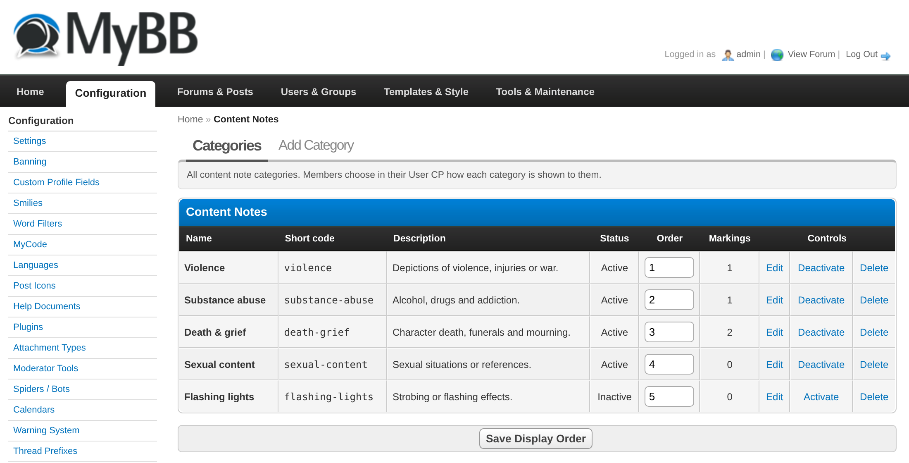

| Field | Meaning |
|---|---|
| Name | Shown in warnings, badges and in the User CP (max. 100 characters) |
| Short code | Unique code used in the MyCode, e.g. `violence` (lowercase letters, digits, `-`, `_`; max. 50 characters) |
| Description | Optional, shown next to the category in the User CP |
| Active | Inactive categories can no longer be chosen when writing; existing markings keep working |
| Free text required | If enabled, a hint is mandatory whenever this category is chosen (form and `[cw=code]` passages); posts without it are rejected |
| Display order | Categories are sorted by this number |

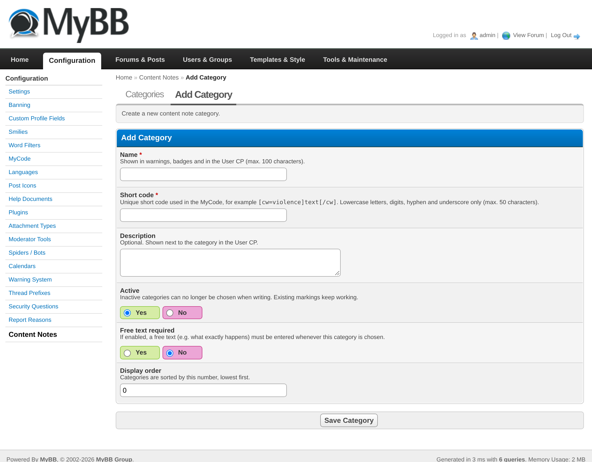

Activating, deactivating and deleting ask for confirmation. **Deleting a category also deletes all markings with this category
and the members' settings for it.** Changing a short code means existing `[cw=old-code]` markings in posts show a generic
content note instead of the category.

A set of 14 default categories can be created with `php inc/plugins/contentnotes/seed-categories.php` (run from the MyBB root;
existing categories are never overwritten).

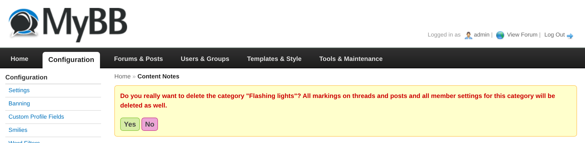

### Marking threads and posts
Members of the allowed groups see a collapsible **Content notes** section in *New Thread*, *New Reply*, the quick reply and
*Edit Post*. Tick one or more categories and optionally add a short hint for each (max. 255 characters).

- Writing a **thread** (or editing its first post) sets notes on the **thread**.
- Writing a **reply** (or editing any other post) sets notes on that **post**.

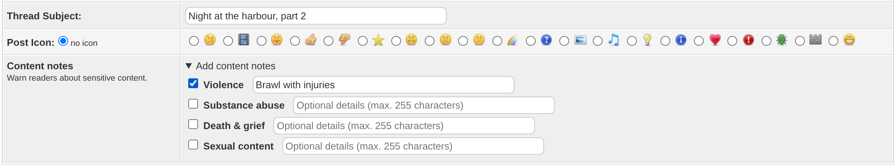

### Marking a passage
Wrap the passage in the MyCode `[cw=short-code|optional hint]…[/cw]`, for example
`[cw=violence|knife fight]The blade flashed.[/cw]`. The hint is optional (`[cw=violence]…[/cw]`), and the code and hint can also
be put in quotes (`[cw="violence|a hint"]…[/cw]`, which is what the editor writes back). Everybody can use the MyCode; the
**editor button** (warning triangle) is only shown to the allowed groups.

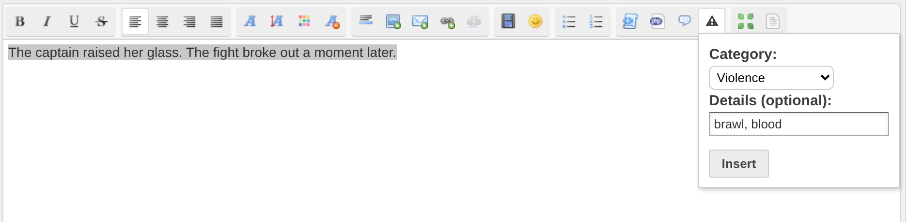

The passage stays inline in the text and does not break the reading flow: a small label followed by blurred text; a click
(or Enter/Space) reveals it.

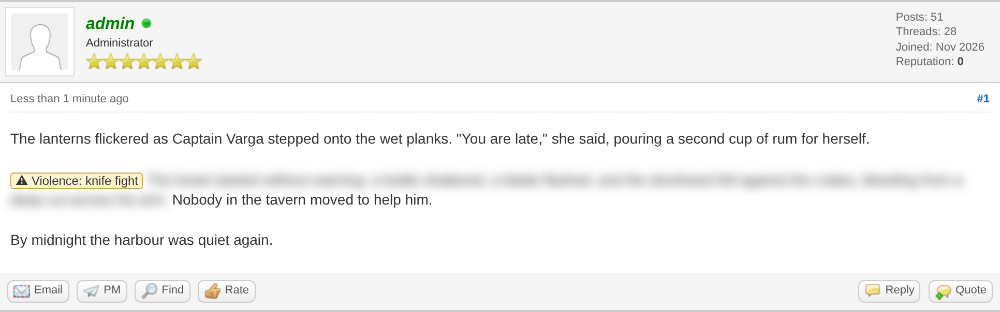 

### What readers see
Each member chooses per category in **User CP → Content Notes**.

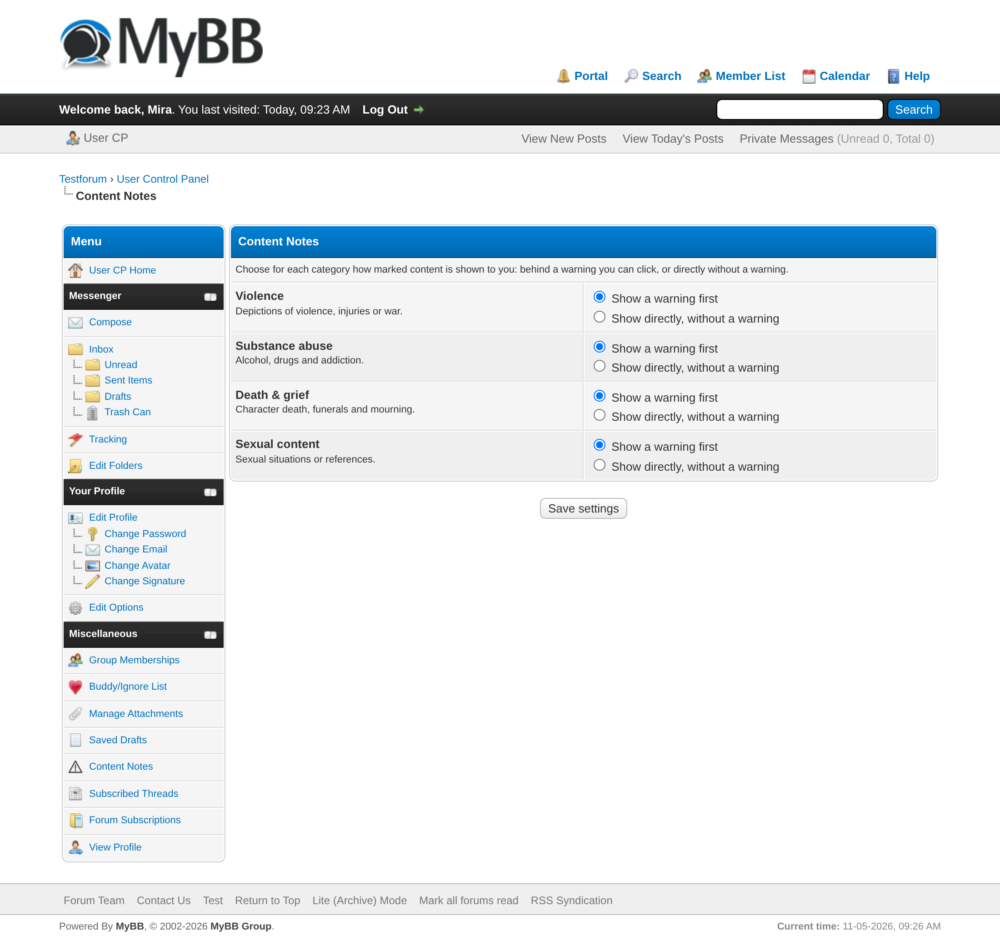

| Setting | Thread | Post | Passage |
|---|---|---|---|
| **Show a warning first** (default) | Badge in the thread list, warning box in the thread, posts hidden until "Show content" is clicked | Warning box, message hidden until clicked | Label + blurred text, click to reveal |
| **Show directly, without a warning** | Badge only | Unchanged | Plain text |
| **Hide completely** | Removed from forum lists and search results; opening it directly shows a short notice | Removed from the thread view | Removed without a trace |

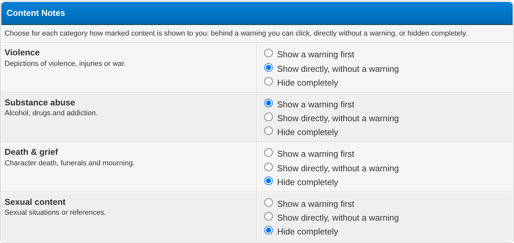

- If something carries several categories, the **strictest setting wins** (hide > warning > show directly).
- **Guests** always get the warning and never have content hidden.
- The **preview** while writing never hides content.
- Without JavaScript nothing is hidden or blurred, so everything stays readable (the warning box is still shown).

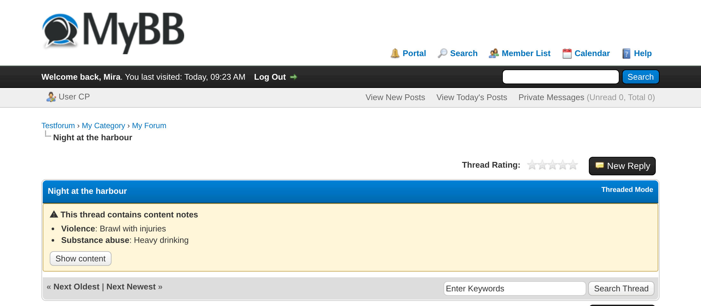
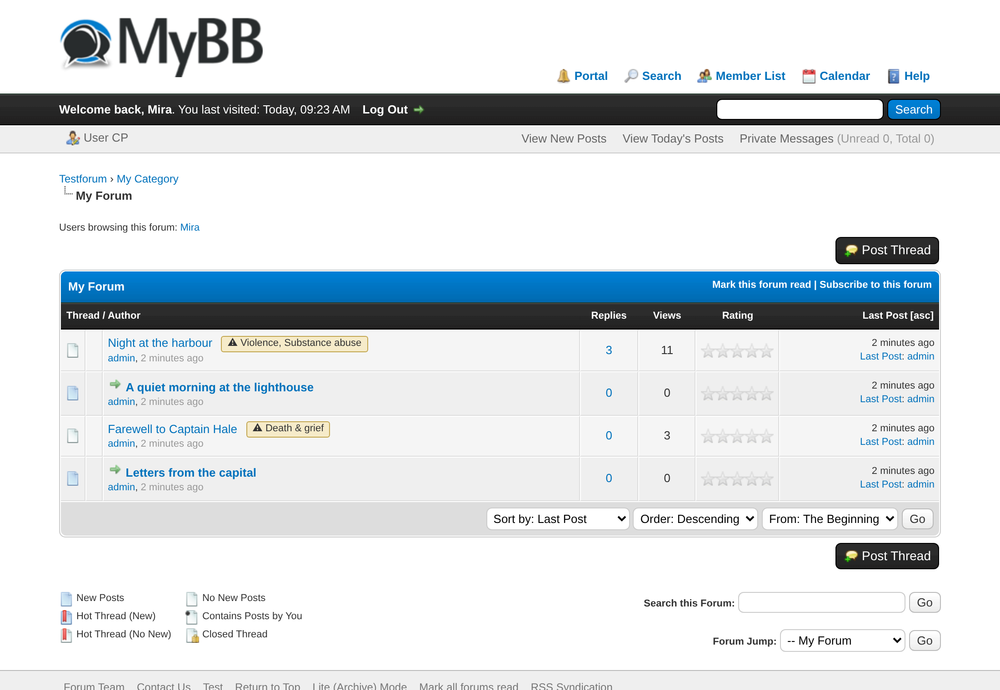
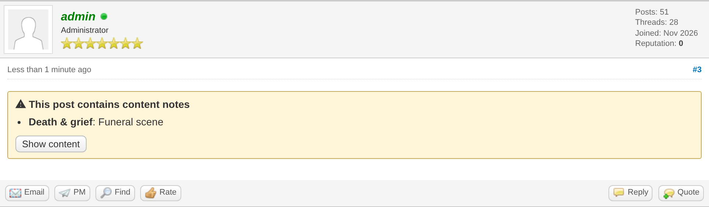

### Tips & Tricks
- "Hide completely" only removes elements from the finished page: counters, pagination and post numbers stay as they are.
- Content notes are not shown in places the plugin does not touch (index "last post", portal, subscription lists, quotes).
- The reveal state is not remembered; clicking "Show content" applies to the current page view only.
- In the threaded display mode the thread-level warning box is not shown (warnings on single posts work in both modes).
- Quick edit directly in the thread does not change content notes; use the full editor for that.

## Configuration
ACP → Configuration → Settings → **Content Notes**

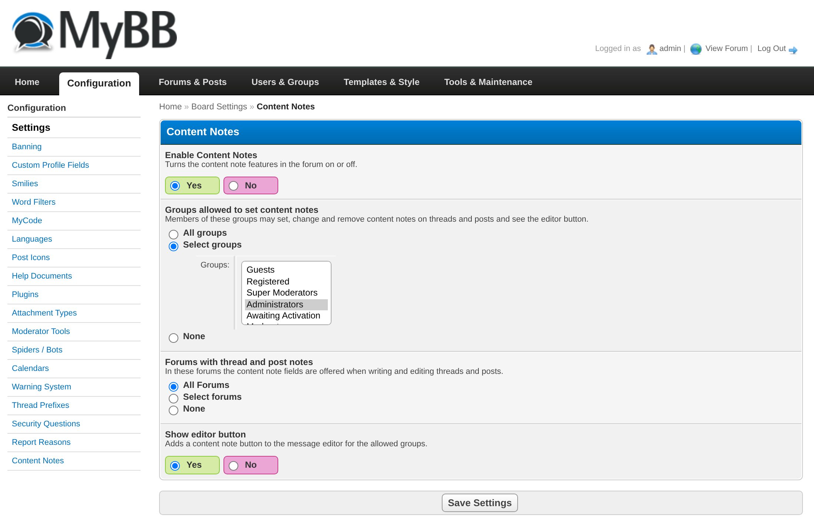

- **Enable Content Notes** – turns the features on or off (default: yes). When off, `[cw]` tags are removed and the text stays.
- **Groups allowed to set content notes** – groups that may set, change and remove notes on threads and posts and see the editor
  button (default: Administrators).
- **Forums with thread and post notes** – forums where the form fields are offered (default: all forums).
- **Show editor button** – adds the content note button to the message editor for the allowed groups (default: yes).

## For developers
- Public functions: `contentnotes_get_notes($type, $id)` (no read permission check), `contentnotes_viewer_action(array $cids)`
  (`hide`/`warn`/`show` for the current viewer), `contentnotes_viewer_wants_warning()`, `contentnotes_viewer_hides()`.
- Hook `contentnotes_notes_saved` with `['type' => 'thread'|'post', 'refid' => …, 'cids' => […]]` after notes were saved.
- Tables: `contentnotes_categories`, `contentnotes_notes`, `contentnotes_userprefs`.
- `tests/` contains a CLI lifecycle helper and a self-test (see `PROJECT_CONTEXT.md`).

## Uninstallation
ACP → Configuration → Plugins → **Content Notes** → Deactivate, then Uninstall. This removes all tables (categories, markings,
member settings), settings, templates and stylesheets. Deactivating alone keeps your data and settings.

## Changelog
See [CHANGELOG.md](CHANGELOG.md).

## Branch `h4w` (H4W theme)

The `h4w` branch differs from `main` only in `inc/plugins/contentnotes/templates/contentnotes_form.tpl` (and a small CSS block at
the end of `contentnotes.css`): the H4W theme builds the write forms as a flex container (`.h4w-post-container` with
`.h4w-post-item` divs, label/field alternating) instead of a table, so the form is two `
`s instead of a `<tr>`.
Merge `main` into `h4w` (never the other way round); on a conflict in `contentnotes_form.tpl` keep the `h4w` version.
Editor changes (`jscripts/contentnotes.js`, the `.sceditor-button-contentnotes` rule in `contentnotes.css`) are kept in sync between `main` and
`h4w` unless the owner says otherwise: a change made on `main` is merged into `h4w`, and a change made on `h4w` is applied to `main` as well.
`h4w` and `main` currently have the same editor files.
